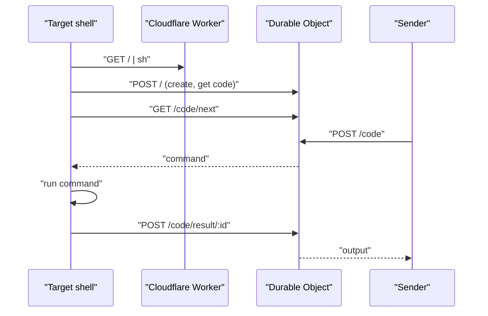

# Shell Over Edge

Reach any shell from anywhere.

Temporary shell access over HTTPS for when SSH, a VPN or open ports aren't an option. Start the agent on the machine you want to reach, then send commands to its code with curl. Everything below is also on [soe.stoff.dev](https://soe.stoff.dev).

## Start the agent

macOS and Linux:

```sh
curl -sS https://soe.stoff.dev | sh
```

Windows PowerShell:

```powershell
irm https://soe.stoff.dev | iex
```

It prints a code and copies it to your clipboard:

```text
Session: 1234abcd (copied to clipboard)
Stop anytime: Ctrl+C
```

## Send commands

```sh
curl https://soe.stoff.dev/1234abcd -d pwd
```

Output comes back as plain text, stdout then stderr, with the exit code in the `X-Exit-Code` header. Exit code 124 means the command timed out.

Pick a working directory or timeout (default 30 seconds, up to 50):

```sh
curl 'https://soe.stoff.dev/1234abcd?cwd=/tmp&timeout=10' -d 'ls -la'
```

Run a script file:

```sh
curl https://soe.stoff.dev/1234abcd --data-binary @deploy.sh
```

Check the session, or end it:

```sh
curl https://soe.stoff.dev/1234abcd
curl -X DELETE https://soe.stoff.dev/1234abcd
```

The status is JSON: `code`, `shell` (`sh` or `powershell`), `platform`, `connected` and `expiresAt`.

## For scripts and agents

Ask for JSON to get the exit code, stdout and stderr separately:

```sh
curl https://soe.stoff.dev/1234abcd -H 'Accept: application/json' -d 'npm test'
```

```json
{ "exitCode": 0, "stdout": "...", "stderr": "" }
```

Send JSON instead of a raw command with `Content-Type: application/json` and `{"command": "npm test", "cwd": "/app", "timeout": 50}`.

Errors are plain text with a status code: 404 unknown session, 410 ended, 413 too large, 429 too many requests, 504 no result in time.

## Limits

| Item            | Limit                 |
| --------------- | --------------------- |
| Session         | 2 hours               |
| Command         | 64 KB                 |
| Output          | 1 MB                  |
| Timeout         | 1-50 seconds          |
| Session lookups | 300 per minute per IP |

The 8-character code is the only key, so treat it like a password and end the session when you're done.

## How it works



One Cloudflare Worker and one Durable Object per session. The Durable Object holds the session, queues commands in order, matches each result to its sender, and deletes itself when the session expires. The agents are plain POSIX sh and PowerShell, with nothing to install.

## Development

Requires [Vite+](https://viteplus.dev). Docker is only needed for `vp run test:containers`.

```sh
vp install
vp dev
curl -sS http://127.0.0.1:8787/ | sh
```

`vp check` formats, lints and type-checks, and runs on every commit. `vp test` runs the end-to-end tests against the real Worker with real POSIX and PowerShell agents. Both run before every deploy.

```sh
vp run test:containers
```
