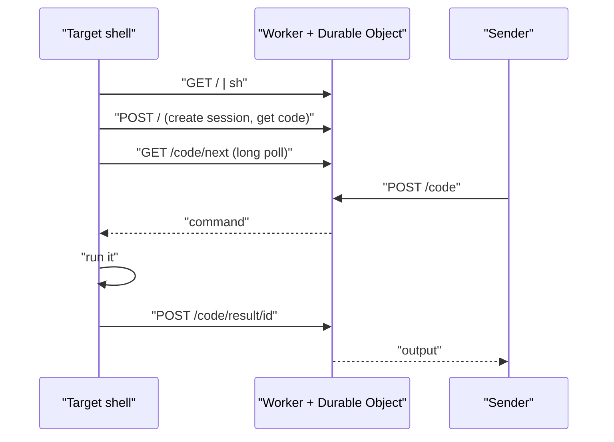

<div align="center">


# reach

**Reach any shell from anywhere.**

Temporary shell access over HTTPS. No SSH, no VPN, no open ports.

[](https://github.com/Stoffbergie/reach/actions/workflows/deploy.yml)
[](https://workers.cloudflare.com)
[](#start-the-agent)
[](./LICENSE)

[Website](https://reach.stoff.dev) · [How it works](#how-it-works) · [Issues](https://github.com/Stoffbergie/reach/issues)

</div>

---

Paste one line on the machine you want to reach. It prints a code. Send commands to that code with curl from anywhere and get the output back. When you're done, press Ctrl+C and the session is gone.

```console
# On the machine you want to reach
$ curl -sS https://reach.stoff.dev | sh
Session: 1234abcd (copied to clipboard)
Stop anytime: Ctrl+C

# From anywhere
$ curl https://reach.stoff.dev/1234abcd -d 'uname -sr'
Linux 6.8.0-45-generic
```

## Features

- **Nothing to install.** The agent is plain POSIX sh or PowerShell, piped straight from curl.
- **Outbound only.** The target only makes HTTPS requests, so it works behind NAT and firewalls that block inbound traffic.
- **Text for people, JSON for machines.** Plain output by default. Ask for JSON to get the exit code, stdout and stderr separately.
- **Safe to run in parallel.** Commands queue in order and every result goes back to the request that sent it.
- **Gone when you're done.** Ctrl+C or `DELETE` ends the session. Sessions expire after 2 hours and delete themselves.
- **No command history on the relay.** Commands and output pass through the service's memory only; it stores session details. Agents use local temporary files.

## Start the agent

```sh
curl -sS https://reach.stoff.dev | sh     # macOS and Linux
irm https://reach.stoff.dev | iex         # Windows PowerShell
```

The agent prints an 8-character code and copies it to your clipboard.

## Send commands

| Do this                      | With                                                              |
| ---------------------------- | ----------------------------------------------------------------- |
| Run a command                | `curl https://reach.stoff.dev/<code> -d pwd`                      |
| Pick a directory and timeout | `curl 'https://reach.stoff.dev/<code>?cwd=/tmp&timeout=10' -d ls` |
| Run a script file            | `curl https://reach.stoff.dev/<code> --data-binary @deploy.sh`    |
| Check the session            | `curl https://reach.stoff.dev/<code>`                             |
| End the session              | `curl -X DELETE https://reach.stoff.dev/<code>`                   |

Output comes back as plain text, stdout then stderr, with the exit code in the `X-Exit-Code` header. Exit code 124 means the command hit its timeout (default 30 seconds, up to 50).

The session check returns JSON with `code`, `shell` (`sh` or `powershell`), `platform`, `connected` and `expiresAt`.

<details>
<summary><strong>For scripts and AI agents</strong></summary>

<br>

Ask for JSON to get the exit code, stdout and stderr separately:

```sh
curl https://reach.stoff.dev/<code> -H 'Accept: application/json' -d 'npm test'
```

```json
{ "exitCode": 0, "stdout": "...", "stderr": "" }
```

Send JSON instead of a raw body and query string:

```sh
curl https://reach.stoff.dev/<code> \
  -H 'Content-Type: application/json' \
  -d '{"command": "npm test", "cwd": "/app", "timeout": 50}'
```

Errors are plain text with a status code:

| Status | Meaning                                     |
| ------ | ------------------------------------------- |
| 400    | Empty command or invalid JSON               |
| 404    | Unknown session                             |
| 410    | Session ended                               |
| 413    | Command over 64 KB                          |
| 429    | More than 300 lookups a minute from your IP |
| 504    | No result in time                           |

Check `shell` in the session status before choosing command syntax. The homepage and the top of each agent script carry the full usage, so `curl https://reach.stoff.dev` explains itself.

</details>

## Security

The 8-character code is the only key to the session. Treat it like a password, share it only with whoever needs the shell, and end the session when you're done. Each IP address gets 300 session lookups a minute, so codes can't be guessed. Commands run as the user who started the agent, with that user's permissions.

## Limits

| Item    | Limit        |
| ------- | ------------ |
| Session | 2 hours      |
| Command | 64 KB        |
| Output  | 1 MB         |
| Timeout | 1-50 seconds |

## How it works



One Cloudflare Worker serves the agent, the website and the API. Each session is a Durable Object named after its code: it holds the session, queues commands in order, matches every result to its sender, and deletes itself with an alarm when the session expires. The agent long-polls for work, so it never needs an open port.

## Development

Requires [Vite+](https://viteplus.dev). Docker is only needed for the container tests.

```sh
vp install
vp dev
curl -sS http://127.0.0.1:8787 | sh
```

| Command                  | What it does                                                                |
| ------------------------ | --------------------------------------------------------------------------- |
| `vp dev`                 | Run the Worker locally                                                      |
| `vp check`               | Format, lint and type-check (also runs on every commit)                     |
| `vp test`                | End-to-end tests against the real Worker with real sh and PowerShell agents |
| `vp run test:containers` | Run the agent in Alpine, Debian and Ubuntu containers                       |
| `vp build`               | Build the Worker for deployment                                             |

Pushing to `main` runs the checks, deploys to Cloudflare and smoke-tests production with a real agent.

## License

[MIT](./LICENSE) © Dirk Beukes
